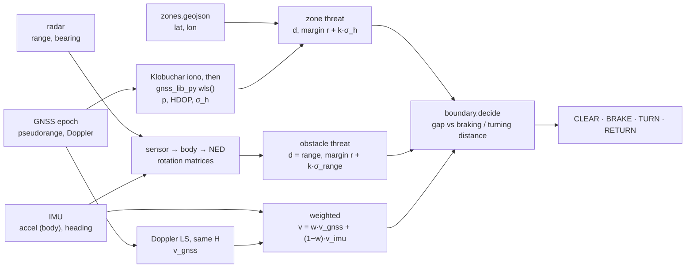

# LAE guardrail: keep an eVTOL out of no-entry zones and away from buildings

Navigation course project (GNSS, least squares, SPP, Doppler, ionosphere,
frame conversion).

Low-altitude economy (LAE) flights in Hong Kong and Singapore share the sky
with restricted zones (for example the zones on the HK CAD eSUA platform) and
with tall buildings. This guardrail sits between the pilot (or autopilot) and
the aircraft. Every GNSS epoch it lets the command through, cuts the speed,
turns away or backs off.

The two kinds of threat are measured differently, so the navigation splits
into two flows:

| | Flow 1: GNSS + IMU | Flow 2: radar |
|---|---|---|
| threat | eSUA-style no-entry zone (GeoJSON) | building |
| distance from | our GNSS position, compared with the map | the sensor, directly |
| margin | `r + k·σ_h`, σ_h = HDOP·σ_UERE ≈ 5–8 m | `r + k·σ_range`, σ_range = 0.5 m |
| velocity | Doppler least squares, weighted with the IMU | same velocity |

**The point:** GNSS error matters for zones (they exist only on the map), but
not for buildings (the radar measures the distance itself). Velocity matters
for both, because it sets the braking and turning distances.



## Course topics in the code

| topic | where |
|---|---|
| SPP, pseudorange least squares | `location.gnss_fix` calls `wls()` from gnss_lib_py: iterate `Δx = (HᵀH)⁻¹HᵀΔρ`, rows `H = [−eᵢᵀ, 1]` |
| DOP | same function: `Q = (HᵀH)⁻¹` in NED, `HDOP = √(Q_NN + Q_EE)`, `σ_h = HDOP·σ_UERE` |
| Doppler velocity | `location.doppler_velocity`: `ρ̇ᵢ − eᵢ·v_sat,i = −eᵢ·v + c·δṫ`, same H, one linear solve |
| ionosphere | Klobuchar model from gnss_lib_py, removed from each pseudorange before the fix |
| frame conversion | ECEF ↔ NED (`LocalCoord`), GeoJSON lat/lon → NED (`boundary.load_zones`), body ↔ NED with `rot(ψ)` for the IMU and radar, sensor → body with `rot(mount)` |
| weighted least squares | GNSS/IMU blend: inverse-variance weights, `w = σ_imu² / (σ_imu² + σ_gnss²)`, σ_gnss = HDOP·σ_ρ̇ |

## The decision (`boundary.py`)

For each threat, with closing speed `v_c = −v·n̂` (n̂ points away from it):

```
gap      = d − margin                         room left
d_react  = v_c·Δt                             flown before a decision acts (Δt = 1.6 s)
d_brake  = d_react + v_c² / (2a)              brake to a stop        (a = 2.5 m/s²)
d_turn   = d_react + R·(1 − sin α)            turn until parallel    (R = 50 m; head-on α = 0)
v_allow  = a·(√(Δt² + 2·gap/a) − Δt)          fastest v_c that can still brake within the gap
```

| state | condition | command |
|---|---|---|
| CLEAR | `v_c ≤ v_allow` | pilot command passes |
| BRAKE | too fast and `gap < d_turn` | closing part of the command cut to `v_allow`, sideways part kept |
| TURN | too fast but `gap ≥ d_turn` | same speed, along the edge |
| RETURN | `gap ≤ 0` | back off at 2 m/s |

Below `v = √(2aR) = 15.8 m/s` braking is the shorter way out; above it,
turning is (`python params.py` prints the table).

**Besides braking and turning distance**, the required distance already has:

* the **reaction distance** `v·Δt` (GNSS period + compute + reaction). At 10 m/s this is 16 m of the 36 m.
* the **margin**: aircraft radius plus `k·σ` of whatever measured the distance.

Not modelled yet (see FUTURE_WORK.md):

* **sensor range**: you cannot react to a building before the radar sees it, so `v ≤ v_allow(SENSOR_RANGE − margin)`, about 23 m/s here.
* **wind**: a tailwind lengthens braking.
* **vertical escape**: climbing as a third option.

## Files

| file | job |
|---|---|
| `params.py` | Predefined numbers (aircraft, latency, k, sensor noise, sky mask). `demo.html` overrides a few at run time; the file never changes. |
| `sim.py` | The real world, simulated: satellites, ionosphere, receiver clock, the aircraft (braking and turning limits), IMU, radar, one building. Test data only. |
| `location.py` | Flow 1 (GNSS fix, Doppler velocity, GNSS/IMU weighting) and flow 2 (radar returns → NED). |
| `boundary.py` | Zones from GeoJSON, threats, braking and turning distances, the decision. |
| `main.py` | The closed loop. `python main.py` flies four scripted flights; `web_*` functions serve the demo. |
| `gnss_lib_py_subset.py` | The parts of Stanford NAV Lab's [gnss_lib_py](https://github.com/Stanford-NavLab/gnss_lib_py) (MIT) used here: `wls`, coordinate frames, elevation/azimuth, Klobuchar. |
| `zones.geojson` | One EXAMPLE no-entry zone. Made up, not a real eSUA zone. |
| `demo.html` | Browser demo. It runs the Python files above with Pyodide. |
| `make_demo.py` | Copies the `.py` files and `zones.geojson` into `demo.html`. |
| `FUTURE_WORK.md` | Features removed in the rebuild, as an improvement plan. |

## Run

```
pip install numpy
python main.py          # four flights, step by step
python params.py        # braking vs turning distance
```

Open `demo.html` in a browser. The first load downloads Pyodide and numpy
(about 10 MB) from cdn.jsdelivr.net, so it needs internet. After editing any
`.py` file or `zones.geojson`, run `python make_demo.py` to refresh the copies
inside the page.

## The demo

The page shows a map with one no-entry zone and one building, and the aircraft
with its radar range, GNSS fix and look-ahead (reaction, braking, turn arcs).
The right side shows the five steps of `main.Flight.step`, with the numbers
returned by the Python each epoch.

* **Click the map** to move the pilot's target, or use *Fly at: Zone / Building*.
* **Parameters** (a closed dropdown): the page has its own values for cruise
  speed, aircraft radius, k, latency Δt, sky blockage and σ_UERE, and hands
  them to `params.py` at run time. *Apply now* changes them mid-flight. Try
  raising *Sky blocked below* to 50° to lose GNSS. Everything else (turning
  radius, braking, sensor, IMU) is predefined in `params.py` and listed there
  read-only.
* Things to try: fly at the building at 10 m/s (BRAKE), then at 20 m/s (TURN).
  Fly at the zone with *Sky blocked below* 15° and then 40°: it stops further
  out.

## Results (`python main.py`, seed 1)

| flight | what happens | closest true distance |
|---|---|---|
| 1. zone, 10 m/s, open sky (8 satellites, HDOP 1.03) | BRAKE from t = 19 s, when the gap to the margin falls below the braking distance (36 m at 10 m/s); then hovers at the margin | zone 15.1 m |
| 2. building, 20 m/s | TURN 98 m from the tower (braking would need 113 m, turning 76 m), slides along it and flies round | building 16.2 m |
| 3. zone, street canyon, sky mask 40° (5 satellites, HDOP 1.47) | margin grows from 18.6 to 25.6 m; it hovers 25 m out instead of 20 m (mean of 10 seeds) | zone 15.8 m |
| 4. zone, sky blocked from t = 10 s | IMU dead reckoning, σ_h grows as ½σ_a·t², the margin grows and it backs away | zone 45.2 m |

The aircraft radius is 3 m, so none of these breach. Across 9 cases × 10
seeds (including 25 m/s, Δt = 3 s, and σ_UERE = 10 m with k = 2), none of the
90 flights breached.

## The GNSS library, and why only part of it

The position, frames and ionosphere come from gnss_lib_py, copied into one
file with function bodies unchanged. The only edits are the imports and the
Klobuchar inputs, marked `# CHANGED:`. The full package also installs pandas,
scipy, matplotlib, plotly and georinex, which the browser demo cannot load.

gnss_lib_py has no Doppler velocity solver, so `doppler_velocity` (10 lines)
and the GNSS/IMU weighting are this project's own code.

Also considered:

* **laika** (comma.ai): has a velocity fix, but builds it with sympy.
* **rtklib-py** and **MobileGNSS-SPP**: RTKLIB ports that need RINEX observation and navigation structures.
* **pyrtklib** (PolyU IPNL): a C extension that needs RINEX. The right tool for real UrbanNav data (FUTURE_WORK #20).

## Limits

The world is simulated: white-noise GNSS errors, one sky mask instead of real
building shadows, no NLOS, a radar that sees everything in range, level
flight, no wind. The guardrail is not a path planner: if the pilot keeps
pushing into a zone, the aircraft waits at the margin. See `FUTURE_WORK.md`.
