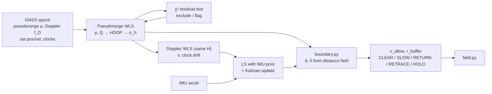

# SPP geofence: least squares, used three ways

A drone geofence where every safety number comes from the course's
single-point-positioning least squares:

| LS output | becomes | used for |
|---|---|---|
| position `p`, cofactor `Q = (HᵀWH)⁻¹` | `HDOP`, `σ_h = HDOP·σ_UERE` | buffer width `k·σ_h` |
| Doppler LS velocity `v` (same `H`) | closing speed `v_close` | buffer growth `v·Δt`, the speed field, retracing |
| residuals `r`, `SSE ~ χ²(n−4)` | exclude a bad satellite, or flag the fix | trusting `σ_h` and `n̂` at all |

```
r_buffer = r_drone + k·σ_h + v_close·Δt
v_allow  = clip((d − r_drone − k·σ_h) / Δt, −V_return, V_max)
```

`v_allow` is a signed speed field. Positive: the fastest the drone may close
on the nearest fence. Negative: it is inside the stop line and is pushed back
out at that speed (section 5).

Urban canyon → fewer satellites, worse geometry → higher HDOP → bigger buffer →
the drone slows down earlier near fences, without any extra rule.



## Files

| file | job |
|---|---|
| `params.py` | Design inputs only: drone radius, timing (`Δt`), risk → `k`, noise sigmas, χ² false-alarm rate, filter noise. Nothing measured lives here any more. |
| `spp.py` | Pseudorange WLS, Doppler WLS, DOPs, χ² fault detection and exclusion, the velocity filter. Outputs `NavSolution` with `p_enu`, `v_enu`, `sigma_h` per epoch. |
| `boundary.py` | Fence polygons (lat/lon) → local metres → precomputed signed distance field. Speed field `v_allow`, state, velocity command, and `ReturnGuard` (push-back and retrace). |
| `sim.py` | Synthetic epochs with known truth (constellation, canyon, NLOS, drone, IMU). Test data only, not course content. |
| `drone_game.html` | The demo: fly a drone through open park, streets and a deep canyon. Every input from `params.py` is editable, the speed field is drawn in colour, and a panel shows each decision step live. Open it in a browser. |
| `velocity_demo.html` | Slide deck on where `v` comes from (Doppler LS, χ² test, IMU prior). |
| `field.py` | Unchanged. It is not in this repo yet; copy it in. See "Hooking up field.py" below. |

Only `numpy` is needed (Python 3.10+).

```
python params.py      # derived k, Δt and a buffer table
python spp.py         # self-test: open sky, injected fault, urban canyon
python spp.py my.csv  # run on your own epochs (format below)
python boundary.py    # closed loop: push at a fence (RETURN), enter a canyon (RETRACE)
```

---

## 1. Position, covariance and the fence buffer

For satellite `i` with corrected pseudorange `ρ_i` (satellite clock added back,
troposphere removed, Earth rotation applied to the satellite position):

```
ρ_i = ‖s_i − x‖ + b + ε_i          b = c·δt (receiver clock, metres)
e_i = (s_i − x) / ‖s_i − x‖         unit line of sight, receiver → satellite
H   = [ −e_iᵀ  1 ]                  one row per satellite
Δρ  = ρ − (‖s − x₀‖ + b₀)
Δx  = (HᵀWH)⁻¹ HᵀW Δρ               iterate until Δx is tiny (spp.solve_position)
```

Weights are dimensionless, `w_i = sin²(el_i)`, so a zenith satellite has
weight 1 and satellite `i` has `σ_i = σ_UERE / sin(el_i)`. With that scaling

```
cov(x̂) = σ_UERE² · Q,     Q = (HᵀWH)⁻¹                    (4×4)
Q_ENU  : the same Q built from rows [ −(R·e_i)ᵀ  1 ]    (R = ECEF→ENU)
HDOP   = √(Q_EE + Q_NN)
σ_h    = HDOP · σ_UERE                                  (2-D rms, "drms")
```

`spp.py` also reports the classic equal-weight HDOP (`hdop_geom`) so you can
compare with the lecture definition.

**Choosing k.** For a circular 2-D Gaussian, `P(|error| > k·drms) = e^(−k²)`.
`params.P_EXCEED = 1e-4` gives `k = √(−ln 1e-4) = 3.03`.

## 2. Velocity from Doppler (how `v` is calculated)

The receiver measures Doppler `f_D` in Hz. Convert it to range rate (positive
Doppler means the satellite is getting closer, so the range is shrinking):

```
ρ̇_i = −λ · f_D,i          λ = c / f_L1 = 0.1903 m
```

The range rate is the relative velocity along the line of sight, plus the
clock drifts:

```
ρ̇_i = e_iᵀ (v_sat,i − v_u) + c·δṫ_u − c·δṫ_sat,i
```

Everything about the satellite is known from the ephemeris, so move it to the
left. What is left is linear in the unknowns `[v_u, c·δṫ_u]`:

```
z_i = ρ̇_i − e_iᵀ v_sat,i + c·δṫ_sat,i  =  −e_iᵀ v_u + c·δṫ_u
z   = H · [v_u ; c·δṫ_u]                with the SAME rows H = [ −e_iᵀ  1 ]
v̂   = (HᵀWH)⁻¹ HᵀW z                    one shot, no iteration
cov = σ_ρ̇² · Q                          σ_v,h = HDOP · σ_ρ̇
```

Code path (`spp.SPP.step`):

1. `los_geometry` gives `e_i` and Earth-rotation-corrected satellite velocities at the final position fix.
2. `doppler_system` builds `z` and `H` (rows rotated into ENU so `v` comes out as east/north/up).
3. `fde(solve_velocity, …)` solves and runs the χ² test on the Doppler residuals with `σ_ρ̇`.
4. The filter (section 4) blends that with the IMU prediction.

Same geometry, same weights, same HDOP. Bad geometry inflates velocity noise
exactly as it inflates position noise.

In the buffer, `v` is the **closing speed** `v_close = max(0, −v·n̂)`, where
`n̂` is the distance-field gradient (pointing away from the nearest fence).
Flying parallel to a fence does not grow the buffer. Set
`params.USE_CLOSING_SPEED = False` to use `|v|` instead.

## 3. Filter 1: residual χ² test (RAIM-lite)

After any solve, the weighted residuals tell you whether the measurements
agree with each other:

```
r   = Δρ − H·Δx
SSE = rᵀ W r / σ²   ~  χ²(n − 4)     if all satellites are healthy
```

`spp.fde` (used for both pseudoranges and Doppler):

1. If `n − 4 < 1`: no redundancy, nothing to test.
2. If `SSE ≤ T(n−4, P_fa)`: pass. The threshold is the exact χ² quantile (`chi2_threshold`, no scipy).
3. Otherwise drop the satellite with the largest **standardised** residual
   `|r_i| / √(W⁻¹ − H Q Hᵀ)_ii` and solve again. Exclusion needs `n ≥ 6`, so the reduced set can still be tested.

The position fix is **verified** only if the test passes with at least
`params.MIN_DOF_INTEGRITY = 3` redundant satellites left. An unverified fix
still reports a position, but `σ_h` is raised to `SIGMA_H_FALLBACK = 50 m`.
The buffer then grows to about 150 m, so the drone stays well away from fences
until the sky opens up.

Why 3 and not 1: in the synthetic deep canyon (5–6 satellites, 2–3 of them
NLOS) two biased satellites can hide inside a 1–2 dof residual space. With
`MIN_DOF_INTEGRITY = 1` the self-test had 117 of 180 epochs where the true
error was larger than `k·σ_h`. With 3 there were none, and open sky is
unaffected because it normally has 4–5 dof.

## 4. Filter 2: least squares with an IMU prior (= Kalman filter)

State `x = [v_E, v_N, v_U, c·δṫ]`. Each epoch (`spp.VelocityFilter`):

```
predict   x⁻ = x + [a_imu·Δt ; 0]
          P⁻ = P + diag((σ_a·Δt)², (σ_a·Δt)², (σ_a·Δt)², σ_d²·Δt)

update    x̂ = argmin  ‖z − Hx‖²_(W/σ_ρ̇²)  +  ‖x − x⁻‖²_(P⁻⁻¹)
            = (HᵀR⁻¹H + P⁻⁻¹)⁻¹ (HᵀR⁻¹z + P⁻⁻¹x⁻)       R⁻¹ = W/σ_ρ̇²
          P = (HᵀR⁻¹H + P⁻⁻¹)⁻¹
```

That is the Kalman update in information form: `spp.py` checks it against
`x⁻ + K(z − Hx⁻)` and they agree to 1e-14. Two consequences you can show:

* **The trade-off is a single knob.** `σ_a` small means trusting the IMU, large means trusting GNSS. Down-weighting low-elevation satellites in `W` is the course-legit version of "trust GNSS less".
* **It keeps working with fewer than 4 satellites.** The prior adds four pseudo-measurements, so 1–3 Doppler rows still improve `v`. With 0 rows the filter coasts on the IMU and its `σ` grows.

**Unverified Doppler is de-weighted.** If the Doppler χ² test does not pass
with `MIN_DOF_INTEGRITY` spare satellites, its rows get `σ_ρ̇ × 5`
(`UNVERIFIED_RR_SCALE`), so the IMU prior carries `v`. In the NLOS canyon the
raw Doppler velocity can be about 4 m/s wrong, nearly opposite the true
motion. Following it made dead-reckoned retracing drift up to 95 m. With the
de-weighting, retrace lands within 0–6 m (8 seeds), and canyon velocity error
drops from 0.94 to 0.70 m/s. Pure IMU (`× 1000`) was worse, at 1.2 m/s, because it
drifts over long canyon stretches.

The simulated IMU reports the mean acceleration over each epoch (delta-v / dt),
as a real IMU's integrated output does.

Without IMU data the prior is constant velocity with `SIGMA_ACC_NO_IMU`.
Position stays a snapshot fix, so `σ_h` keeps its direct HDOP meaning.

## 5. Closing the loop and returning the drone (`boundary.py`)

```
d        = signed distance from p̂ to the nearest fence edge (+ = allowed side)
n̂        = ∇d / |∇d|                    (points away from the fence)
v_allow  = clip((d − r_drone − k·σ_h) / Δt, −V_return, V_max)
```

`d ≥ r_buffer` solved for the closing speed gives `v_close ≤ v_allow`. The
whole decision is that one inequality, plus what to do when it cannot be
trusted.

**Verified fix** (χ² passed with ≥ `MIN_DOF_INTEGRITY` spare satellites): `n̂` is trusted.

| state | condition | command (`limit_velocity`) |
|---|---|---|
| CLEAR | `v_close ≤ v_allow` | stick passes through |
| SLOW | `0 ≤ v_allow < v_close` | closing part cut to `v_allow`, sideways part kept |
| RETURN | `v_allow < 0` (inside the stop line `r_drone + k·σ_h`) | closing part forced to `v_allow`: pushed out along `n̂` at up to `V_return` |

SLOW and RETURN are the same line of code, `closing ≤ v_allow`. A negative
`v_allow` turns the cap into a push-back.

**Fix not verified** (`σ_h` → 50 m fallback): `n̂` is not trusted.

| state | condition | command |
|---|---|---|
| CLEAR / SLOW | `v_allow ≥ 0` | whole speed `|v|` capped at `v_allow` (`cap_speed`), direction kept |
| RETRACE | `v_allow < 0` | fly back to the last verified fix, steering by dead reckoning |
| HOLD | no fix, never verified, or retrace done | hover until a verified fix |

RETRACE is the "logic of return" when position cannot be trusted. The drone
got to its last verified fix safely, so going back there is safe.
`ReturnGuard` keeps that fix `p_lv` and a dead-reckoned position
`p_dr = p_lv + Σ v̂·Δt`, built from the filtered velocity (Doppler + IMU, section 4).
It commands `(p_lv − p_dr)/|…| · min(V_return, dist/Δt)`. Once there, it holds
instead of continuing to dead-reckon, because a slightly biased `v̂` would make a
"hovering" drone wander. Normal logic resumes as soon as a fix is verified.

History of this design:
1. An early version only cut the closing component at the stop line and kept
   the sideways part. In the NLOS canyon it flew straight through a fence,
   because `n̂` at a 100 m-wrong estimate pointed the wrong way. So unverified
   fixes never use `n̂`.
2. Retrace first integrated raw canyon Doppler and drifted up to 95 m. That is
   why the filter now de-weights unverified Doppler.

`Δt = 1/rate + compute + reaction = 1.0 + 0.1 + 0.5 = 1.6 s`: the time the drone
keeps flying at `v` before a new command takes effect.

The distance field is computed once on a 2 m grid (`DistanceField`); look-ups
are bilinear, with an exact fallback off the grid. Fences are `keep_out`
(restricted zones) or `keep_in` (approved operating area). `EXAMPLE_FENCES`
are made-up polygons around the default origin. For real zones, export them
as GeoJSON and use `load_geojson()`.

## Self-test results

`python spp.py` (synthetic, seed 3, 180 s at 8 m/s):

| case | sats | HDOP | pos rms | predicted σ_h | vel rms raw → filtered | χ² |
|---|---|---|---|---|---|---|
| open sky | 9.0 | 1.76 | 8.85 m | 8.82 m | 0.36 → 0.27 m/s | 1 exclusion |
| + 60 m fault on one satellite for 90 s | 8.5 | 1.86 | 9.18 m | 9.28 m | 0.38 → 0.29 m/s | 91 exclusions, error unchanged |
| deep canyon, NLOS | 5.5 | 2.83 | 56 m | 50 m (fallback) | 1.66 → 0.70 m/s | every epoch unverified, 0 misleading |

`python boundary.py` (stick held at 10 m/s towards restricted zone A for 70 s):

| case | states (epochs) | outcome | breach |
|---|---|---|---|
| open sky | CLEAR 21, SLOW 15, RETURN 34 | slows from 48 m, pushed back and held about 28 m out, closest 17 m | no |
| street canyon, 15 m buildings | same pattern | held about 31 m out | no |
| deep canyon from the start | HOLD 70 | never verified, never moves | no |
| open sky, deep canyon from t = 17 s | CLEAR 17, RETRACE 7, HOLD 46 | retraces to 4 m from the last verified fix, then holds | no |

Across seeds 1–8, none of the 32 runs breached. Retrace landed within 0–6 m
of the last verified fix on every seed.

## Running on UrbanNav

UrbanNav ships RINEX observation and navigation files. `spp.py` takes epochs
that already have satellite positions, so compute those with your lab's
ephemeris code (or RTKLIB) and write one CSV row per satellite per epoch:

| column | unit | required |
|---|---|---|
| `t` | s | yes (time tag; rows with the same `t` form one epoch) |
| `prn` | text | yes |
| `x, y, z` | m, ECEF at transmit time | yes |
| `pr_m` | m, raw pseudorange | yes |
| `vx, vy, vz` | m/s, ECEF | for velocity |
| `rr_mps` **or** `doppler_hz` | m/s or Hz (`rr = −λ·f_D`) | for velocity |
| `clk_m` | m, `c·δt_sat` (added to `pr`) | recommended |
| `clk_drift_mps` | m/s, `c·δṫ_sat` | optional |
| `iono_m` | m, e.g. Klobuchar (subtracted) | optional |
| `acc_e, acc_n, acc_u` | m/s², IMU in ENU, gravity removed | optional (filter) |

`sim.write_csv()` writes this format if you want a template. Move
`params.ORIGIN_*` to the start of your run so ENU stays small.

Two things to check on real data:

* If your satellite positions are already corrected for Earth rotation, set `APPLY_EARTH_ROTATION = False`, or the correction is applied twice.
* GPS only: `H` has one clock column. Adding Galileo or BeiDou means one inter-system bias column per extra constellation, and it also gives the χ² test the redundancy it needs in canyons.

## Hooking up field.py

`field.py` is not in this repo, so its interface was not available when this
was written. Whatever it reads, the values now come from here:

```python
from spp import SPP
from boundary import DistanceField, ReturnGuard, example_fences

solver = SPP()
guard = ReturnGuard(DistanceField(example_fences()))   # or load_geojson("esua.geojson")

sol = solver.step(epoch)                    # sol.p_enu, sol.v_enu, sol.sigma_h, sol.integrity
v_cmd, chk = guard.step(sol, v_goal, dt)    # chk.state, chk.d, chk.n_hat, chk.v_allow, chk.r_buffer
```

If `field.py` used to read `p`, `v`, `sigma` from `params.py`, point those
reads at `sol.p_enu`, `sol.v_enu` and `sol.sigma_h` instead.

## The game (`drone_game.html`)

Fly with WASD / arrow keys, or press and hold on the map. Collect rings 1–5,
then return to H. The map has an open park (10 satellites), streets with
15 m buildings (7 satellites, HDOP 2.5, still verifiable) and a deep canyon
with 30 m buildings (5 satellites, never verifiable).

* **Speed field in colour.** Bands show `v_allow` for the current `σ_h`. Teal to amber means you may approach at most that fast; magenta means inside the stop line, with arrows showing the push-back direction `n̂`. The bands breathe as `σ_h` changes between districts.
* **Decision panel.** Every epoch it lists the questions `check()` and `ReturnGuard.step()` ask, with the numbers: fix? verified (χ², n−4)? inside the stop line (`v_allow` worked out)? closing too fast? The result and the exact command follow.
* **Inputs.** Everything in `params.py` that shapes the decision is editable: `r_drone`, `V_max`, `V_return`, GNSS rate, compute and reaction time (→ Δt), the risk (→ k), `σ_UERE`, `σ_ρ̇`, min redundancy, fallback `σ_h`, IMU `σ_a`. Values are remembered in the browser.
* **Things to try.** Push into a fence and let go (SLOW → RETURN). Fly into the deep canyon (RETRACE to the blue diamond). Press `L` to turn the logic off and breach. Raise `σ_UERE` or the reaction time and watch the bands grow.

The game models LOS-only satellites with time-correlated pseudorange errors;
NLOS reflections are only in `sim.py`.

## Limits

* **NLOS is not geometry.** HDOP covers geometry only. A reflected signal adds a bias that HDOP cannot see, which is why the χ² test and `MIN_DOF_INTEGRITY` exist. In a deep GPS-only canyon the honest answer is "not verified", so the drone keeps a big buffer.
* **Elongated ellipses.** `k` assumes a circular error. Canyon geometry stretches the ellipse across the street, which makes the tail heavier along that axis. `NavSolution.sigma_major` (1-σ semi-major axis) is reported; using it instead of `σ_h` is the conservative option.
* **White-noise simulator.** Real multipath is time-correlated, so real residuals look smoother and biases persist for longer than in `sim.py`.

## Future work: sensors

Sensors (camera, lidar, radar) stay on the future-work slide. Teaser: the
same buffer logic gives "you can't outrun your headlights": with sensing
range `R_s`, the speed must satisfy `R_s ≥ r_drone + v·Δt + v²/(2a)`.
